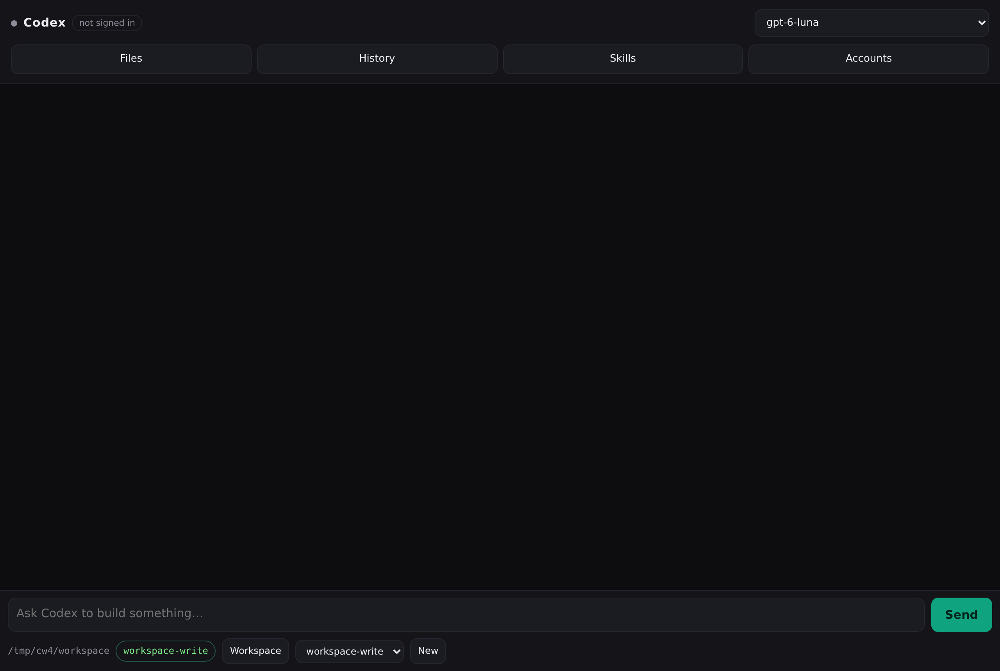
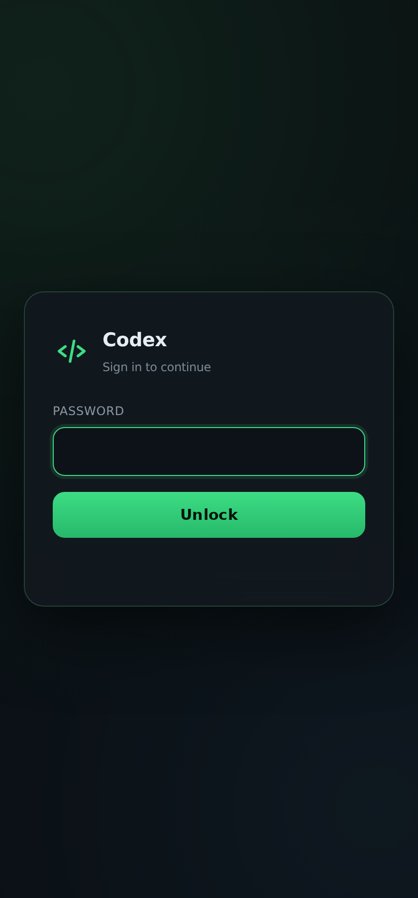

# Codex

The real Codex CLI behind a web screen you can use from a phone.

A browser front end for the `codex` binary that ships inside the ChatGPT
desktop package: streaming chat, model picker, workspace file browser, session
history with resume, skills, and a multi-account pool. Nothing is mocked -- every
reply comes from the CLI running on the machine.



<p align="center"></p>

---

## What is in here

| Path | What it does |
|---|---|
| `codex-web.py` | The front end. Serves the page and the JSON API, and runs `codex` as a subprocess per request, streaming its stdout. |
| `codex-web.html` | The whole UI in one file: chat, file browser, history, skills, accounts, model picker. |
| `codex_accounts.py` | Account pool. Each account gets its own `CODEX_HOME` under `~/.codex/accounts/<slug>/home`, so sessions and credentials cannot leak between them. Reports live quota state and picks the best account to serve a request. |
| `codex_history.py` | Local session titles, stored next to the Codex session files and looked up by account + thread id. |
| `codex_skills.py` | Install, create, and discover skills (Codex's packaged instruction bundles). |
| `codex_chat.py` | Small helper that formats a chat request for the CLI. |
| `codex_web.py` | Launcher + reverse proxy. Starts the front end and exposes it under one path prefix with a per-process secret token. |
| `router.py` | Optional front door: a password login with a signed cookie on top of `codex_web`. |
| `official_skills/` | The skills that ship with the container. |

## Run it

### Locally

```sh
# needs the Codex CLI on PATH
npm --version >/dev/null 2>&1 || true          # not required, just a hint
python3 codex-web.py                            # http://127.0.0.1:8098/<token>/
```

The token is printed on startup. It is the first path segment by design: the
front end refuses any request that does not carry it, so the only way in is
through the proxy that knows it.

### With a password on top (recommended for anything public)

```sh
CODEX_WEB_PASSWORD='choose-something' python3 router.py
```

`router.py` starts the front end on a private loopback port (`PORT+1`) and binds
the public one itself. Open `/`, type the password, and you land on Codex.

### Docker

```sh
docker build -t codex .
docker run -p 8098:8098 -v codex-data:/data/codex-web codex
```

### Fly.io

The bundled `fly.toml` runs one always-on machine with a volume mounted at
`/data`. Set the password as a secret so it never lands in an image:

```sh
fly secrets set CODEX_WEB_PASSWORD='choose-something'
fly deploy
```

## Configuration

Every setting is an environment variable; there are no config files.

| Variable | Default | Meaning |
|---|---|---|
| `PORT` | `8098` | Public port (front end, or the router when run that way). |
| `CODEX_WEB_BACKEND_PORT` | `PORT+1` | Private port the front end actually listens on when the router runs. |
| `CODEX_WEB_PASSWORD` | random, printed once | Password for `router.py`. |
| `CODEX_WEB_SESSION_SECONDS` | `604800` | How long a login cookie stays valid (7 days). |
| `CODEX_WEB_HOME` | `/data/codex-web` | Where sessions, accounts and the workspace live. |
| `CODEX_HOME` | `$CODEX_WEB_HOME/.codex` | Codex's own state directory. |
| `DEFAULT_CWD` | `$CODEX_WEB_HOME/workspace` | The directory the file browser opens in. |
| `CODEX_BIN` | `codex` | Path to the CLI. |
| `LINK_TOKEN` | random | Front-end token. Set it yourself only if you are proxying externally. |
| `CODEX_QUEUE_RETRY` | `300` | Seconds to wait before retrying a rate-limited job. |
| `CODEX_QUEUE_MAX` | `12` | How many times to retry before giving up. |

## How a request works

```
browser ──▶ router.py (password, cookie)  ──▶ codex_web.py (token proxy)
                                                   │
                                                   ▼
                                            codex-web.py  ──▶  codex CLI
                                                   │
                                                   ▼
                                              streaming JSON
```

1. The browser posts a prompt to `/codex-web/api/run`.
2. The front end creates a job, spawns `codex exec ... --json` with the account's
   `CODEX_HOME`, and streams its stdout back as newline-delimited JSON.
3. On a rate limit the job is not failed: it waits `CODEX_QUEUE_RETRY` seconds,
   rotates to the next account that still has quota, and continues.
4. `stop` kills the whole process group, so an interrupted job cannot leave a
   `codex` child running.

## Security notes

- The front end binds `127.0.0.1` unless you set `CODEX_WEB_BIND`. The token in
  the URL is what keeps it private; treat it like a password.
- `router.py` compares the password with `hmac.compare_digest` and sleeps 0.4 s
  on a wrong attempt, then issues an HttpOnly, SameSite=Lax cookie signed with a
  per-process secret. Restarting the process invalidates every session.
- Account homes are resolved through `valid_slug()` and checked with
  `is_relative_to()`, so a crafted slug cannot escape the accounts directory.
- File reads and the workspace browser are confined to `DEFAULT_CWD`. A path
  outside it raises `PermissionError` rather than being silently clamped.

## Requirements

- Python 3.10+ (stdlib only -- there are no third-party packages).
- The Codex CLI. The Dockerfile takes it from the ChatGPT desktop package
  (`chatgpt_amd64.deb`) and symlinks `codex` into `/usr/local/bin`.
- A logged-in ChatGPT account. Signing in happens through the device-code flow
  in the Accounts tab: pick an account, open `auth.openai.com/codex/device`, type
  the code the UI shows.

## License

MIT. See `LICENSE`.
