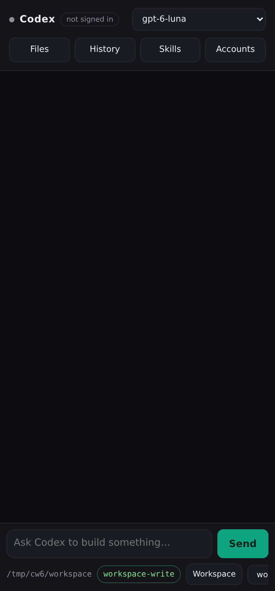

# Codex

The real Codex CLI behind a web screen you can use from a phone.

A browser front end for the `codex` binary that ships inside the ChatGPT
desktop package: streaming chat, model picker, workspace file browser, session
history with resume, skills, and a multi-account pool. Nothing is mocked -- every
reply comes from the CLI running on the machine.


<p align="center"></p>

---

## What is in here

| Path | What it does |
|---|---|
| `codex-web.py` | The front end. Serves the page and the JSON API, and runs `codex` as a subprocess per request, streaming its stdout. |
| `codex-web.html` | The whole UI in one file: chat, file browser, history, skills, accounts, model picker. |
| `codex_accounts.py` | Account pool. Each account gets its own `CODEX_HOME` under `~/.codex/accounts/<slug>/home`, so sessions and credentials cannot leak between them. Reports live quota state and picks the best account to serve a request. |
| `codex_history.py` | Local session titles, stored next to the Codex session files and looked up by account + thread id. |
| `codex_skills.py` | Install, create, and discover skills (Codex's packaged instruction bundles). |
| `codex_chat.py` | Small helper that formats a chat request for the CLI. |
| `codex_web.py` | Launcher + reverse proxy. Starts the front end and exposes it under one path prefix with a per-process secret token. |
| `official_skills/` | The skills that ship with the container. |

## Run it

### Locally

```sh
# needs the Codex CLI on PATH
CODEX_WEB_HOME=./data python3 codex_web.py      # http://127.0.0.1:8098/
```

### Docker

```sh
docker build -t codex .
docker run -p 8098:8098 -v codex-data:/data codex
```

### Fly.io

The bundled `fly.toml` runs one always-on machine with a volume mounted at
`/data`. It needs no secrets; the Codex sign-in lives on that volume.

```sh
fly deploy
```

## Configuration

Every setting is an environment variable; there are no config files.

| Variable | Default | Meaning |
|---|---|---|
| `CODEX_WEB_PORT` | `8098` | Public port this launcher serves. |

| `CODEX_WEB_BACKEND_PORT` | `PORT+1` | Private port the front end listens on (loopback only). |
| `CODEX_WEB_HOME` | `/data/codex-web` | Where sessions, accounts and the workspace live. |
| `CODEX_HOME` | `$CODEX_WEB_HOME/.codex` | Codex's own state directory. |
| `DEFAULT_CWD` | `$CODEX_WEB_HOME/workspace` | The directory the file browser opens in. |
| `CODEX_BIN` | `codex` | Path to the CLI. |
| `CODEX_QUEUE_RETRY` | `300` | Seconds to wait before retrying a rate-limited job. |
| `CODEX_QUEUE_MAX` | `12` | How many times to retry before giving up. |

## How a request works

```
browser ──▶ codex_web.py (owns the public port)
                 │  forwards with a per-process token
                 ▼
           codex-web.py  ──▶  codex CLI
                 │
                 ▼
            streaming JSON
```

1. The browser posts a prompt to `api/run`.
2. The front end creates a job, spawns `codex exec ... --json` with the account's
   `CODEX_HOME`, and streams its stdout back as newline-delimited JSON.
3. On a rate limit the job is not failed: it waits `CODEX_QUEUE_RETRY` seconds,
   rotates to the next account that still has quota, and continues.
4. `stop` kills the whole process group, so an interrupted job cannot leave a
   `codex` child running.

## Access

Codex Web has no password of its own, by design. It gives whoever opens the
page the machine's Codex session -- the same trust boundary as a terminal
running `codex`. That is the right shape for a tool you host for yourself in a
container, behind Fly's proxy or your own reverse proxy, and it means no
password to lose or rotate.

What is still locked down:

- The front end binds `127.0.0.1` and rejects any request that does not carry
  the launcher's per-process token, which arrives in the `X-Codex-Token` header.
  Nothing on the network can reach it directly.
- Account homes are resolved through `valid_slug()` and checked with
  `is_relative_to()`, so a crafted slug cannot escape the accounts directory.
- The file browser and file reads are confined to `DEFAULT_CWD`; a path outside
  it raises `PermissionError` rather than being silently clamped.

If you are putting this on a public address, terminate it at a proxy that does
the authentication (Fly's proxy with a private app, Cloudflare Access, an nginx
`auth_request`, or a WireGuard/Tailscale network), rather than adding a login
form to this code.

## Requirements

- Python 3.10+ (stdlib only -- there are no third-party packages).
- The Codex CLI. The Dockerfile takes it from the ChatGPT desktop package
  (`chatgpt_amd64.deb`) and symlinks `codex` into `/usr/local/bin`.
- A logged-in ChatGPT account. Signing in happens through the device-code flow
  in the Accounts tab: pick an account, open `auth.openai.com/codex/device`, type
  the code the UI shows.

## License

MIT. See `LICENSE`.
